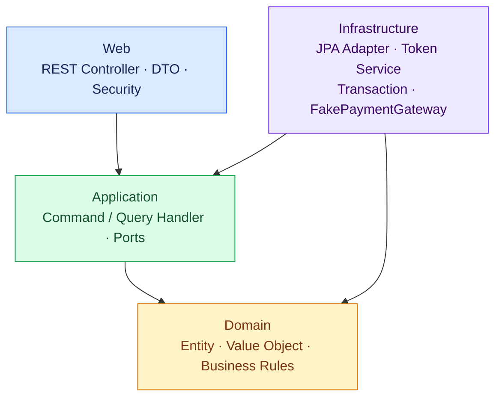
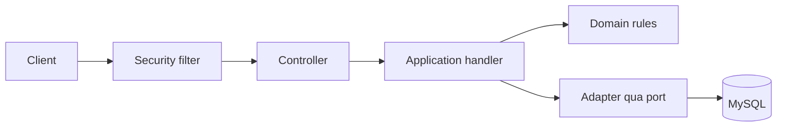
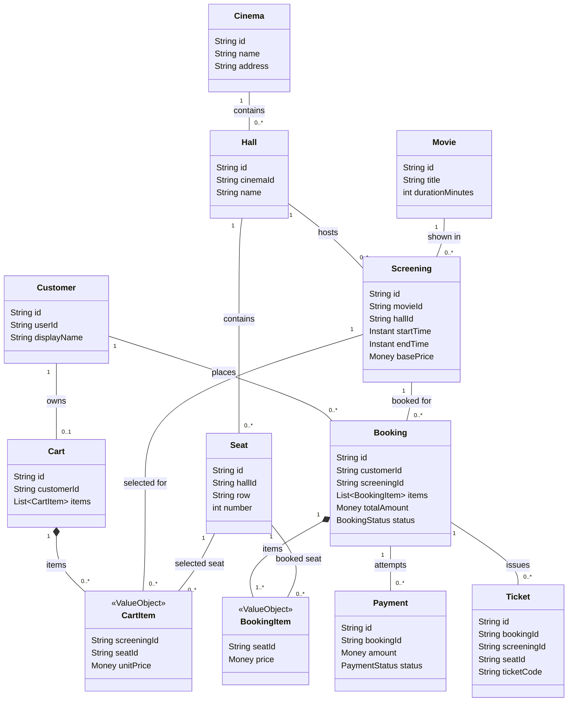

# Cinema — Backend đặt vé xem phim

Cinema là backend đặt vé xem phim trực tuyến, được xây dựng theo Clean Architecture bằng Java và Spring Boot.

README này trình bày bài toán, kiến trúc, cách triển khai, công nghệ, chức năng hiện có và các giới hạn để nhóm tiếp nhận có thể hiểu và tiếp tục phát triển dự án.

**Mốc đối chiếu:** nhánh `main`, commit `2a56574`, ngày 29/10/2026. Các kết quả kiểm thử bên dưới là bằng chứng đã ghi nhận tại những mốc tương ứng, không phải kết quả vừa chạy lại trên commit này.

## 1. Mô tả bài toán

### 1.1. Bối cảnh và mục tiêu

Hệ thống phục vụ việc tra cứu lịch chiếu, chọn ghế, đặt vé và quản lý kết quả đặt vé.

Khó khăn chính là nhiều khách có thể cùng chọn một ghế, gửi lặp yêu cầu hoặc bỏ dở thao tác. Backend phải kiểm soát quyền giữ ghế, trạng thái booking, kết quả thanh toán và việc phát hành vé để dữ liệu không bị mâu thuẫn.

Mục tiêu hiện tại là cung cấp REST API cho các chức năng này. Frontend và thanh toán thật chưa được triển khai.

### 1.2. Người sử dụng

| Đối tượng | Chức năng |
| --- | --- |
| Khách chưa đăng nhập | Xem danh mục rạp, phòng, ghế, phim, suất chiếu và ghế còn trống; đăng ký, đăng nhập. |
| CUSTOMER | Quản lý giỏ hàng, giữ ghế, checkout, thanh toán giả lập, xem booking và vé của mình; hủy booking còn được phép hủy. |
| ADMIN | Tạo dữ liệu danh mục, xóa mềm phim và hủy suất chiếu; vẫn chịu kiểm tra quyền sở hữu khi truy cập booking, payment và ticket. |

### 1.3. Các đối tượng chính

| Đối tượng | Ý nghĩa |
| --- | --- |
| Cinema, Hall, Seat | Rạp, phòng chiếu và ghế vật lý. |
| Movie, Screening | Phim và một lần chiếu tại phòng, thời gian cụ thể. |
| User, Customer | Tài khoản xác thực và hồ sơ khách hàng. |
| Cart, CartItem | Giỏ hàng và các ghế của những suất chiếu được chọn. |
| Booking, BookingItem | Đơn đặt vé cho một suất chiếu và chi tiết ghế, giá đã chốt. |
| Payment | Một lần thử thanh toán cho booking. |
| Seat hold | Quyền giữ ghế trước khi hoàn tất đặt vé. |
| Seat reservation | Ghi nhận ghế đã được đặt thành công. |
| Ticket | Vé được phát hành cho từng ghế sau khi thanh toán thành công. |

Một ghế vật lý có thể được bán cho nhiều suất chiếu khác nhau. Đơn vị cần chống đặt trùng là cặp **suất chiếu–ghế**, không phải ghế độc lập.

### 1.4. Luồng nghiệp vụ

1. ADMIN chuẩn bị rạp, phòng, ghế, phim và suất chiếu.
2. Khách đăng ký, đăng nhập và xem ghế còn trống.
3. Khách chọn ghế; backend kiểm tra và giữ ghế khi thêm vào giỏ.
4. Checkout kiểm tra giỏ, quyền giữ ghế và nhóm các mục theo suất chiếu.
5. Backend tạo một booking `PENDING` cho mỗi suất chiếu.
6. Khách thanh toán từng booking qua gateway giả lập.
7. Nếu thành công, backend xác nhận booking, ghi nhận ghế đã đặt và phát vé.
8. Khách xem booking và vé của mình.

**Các quy tắc quan trọng:**

- Danh sách ghế còn trống chỉ phản ánh thời điểm truy vấn, không bảo đảm ghế vẫn trống khi khách chọn.
- Một giỏ có thể chứa ghế của nhiều suất chiếu; mỗi booking chỉ thuộc một suất.
- Booking lưu giá tại thời điểm checkout.
- Booking đang chờ có thể được hủy theo quy tắc hiện tại; không có API hoàn tiền cho booking đã thanh toán.
- Có giá trị trạng thái trong mô hình không đồng nghĩa đã có API thực hiện mọi chuyển trạng thái.

## 2. Kiến trúc hệ thống

### 2.1. Kiến trúc tổng thể

Backend được tổ chức theo Clean Architecture với bốn tầng:



Các mũi tên mô tả hướng phụ thuộc mã nguồn.

| Tầng | Trách nhiệm |
| --- | --- |
| Domain | Đối tượng miền, giá trị, trạng thái và quy tắc nghiệp vụ; không phụ thuộc Spring, JPA hoặc HTTP. |
| Application | Điều phối ca sử dụng qua command/query handler; khai báo interface cho repository và dịch vụ cần sử dụng. |
| Infrastructure | Triển khai các interface bằng MySQL/JPA, bộ nhớ, dịch vụ token, gateway thanh toán và cấu hình transaction. |
| Web | Controller, request/response, ánh xạ lỗi HTTP, xác thực và phân quyền. |

Các interface ở Application giúp thay thế cách lưu dữ liệu hoặc gateway mà không đưa chi tiết hạ tầng vào Domain.

### 2.2. Tổ chức mã nguồn

```text
src/
├── main/
│   ├── java/cinema/
│   │   ├── domain/
│   │   ├── application/
│   │   ├── infrastructure/
│   │   └── web/
│   └── resources/
│       ├── application.properties
│       ├── application-mysql.properties
│       └── db/migration/
└── test/java/cinema/
    ├── architecture/
    ├── domain/
    ├── application/
    ├── infrastructure/
    └── web/

docs/          Tài liệu thiết kế, API, bàn giao và nghiệm thu
benchmarks/    Công cụ đo tải, kiểm tra API và notebook Kaggle
Dockerfile     Đóng gói ứng dụng
compose.yaml   Chạy backend cùng MySQL
pom.xml        Cấu hình build và thư viện
```

### 2.3. Ví dụ xử lý một request



Sơ đồ mô tả luồng gọi xử lý. Kết quả được trả ngược qua handler và controller thành HTTP response; lỗi được ánh xạ sang phản hồi phù hợp.

Trong profile `mysql`, Infrastructure bao các command handler bằng transaction. Application và Domain không phải trực tiếp quản lý kết nối database.

### 2.4. Class diagram — Các lớp nghiệp vụ chính

Sơ đồ rút gọn thể hiện các lớp và quan hệ nghiệp vụ. Các liên kết theo ID được biểu diễn bằng đường liên kết; không phải mọi quan hệ đều là tham chiếu đối tượng Java hoặc khóa ngoại database. Lược bỏ BaseEntity, Money, enum và các lớp hạ tầng để dễ đọc.



**Cách đọc sơ đồ:**

- Đường liền: association (liên kết giữa các đối tượng).
- Thoi đặc ở Cart và Booking: composition; các item là thành phần thuộc đối tượng chứa.
- `1`, `0..1`, `0..*`, `1..*`: số lượng đối tượng có thể liên kết ở mỗi đầu.
- Không dùng thoi rỗng hoặc tam giác kế thừa khi sơ đồ không biểu diễn quan hệ tương ứng.
- Booking có thể chưa có payment hoặc ticket; nhiều payment biểu diễn các lần thử, nhưng tối đa một payment SUCCESS theo ràng buộc database.
- Ticket còn lưu screeningId và seatId; hai đường tham chiếu này được lược bỏ để giảm giao cắt. Một BookingItem có tối đa một ticket theo ràng buộc booking–ghế.

## 3. Các cơ chế đã triển khai

### 3.1. Xác thực và phân quyền

- Mật khẩu được băm bằng **PBKDF2**.
- Đăng nhập thành công tạo **opaque Bearer token** ngẫu nhiên, thời hạn một giờ; không phải JWT.
- Database chỉ lưu **SHA-256 của token**.
- Khi xác thực, backend kiểm tra định dạng, bản băm và hạn sử dụng.
- Quyền của tài khoản được đọc lại khi xác thực token.
- Đăng ký luôn tạo tài khoản CUSTOMER; client không tự chọn ADMIN.
- Các API được phân quyền theo CUSTOMER/ADMIN và kiểm tra quyền sở hữu tài nguyên.
- Đăng nhập nhiều lần có thể tạo nhiều token còn hiệu lực; cấp token mới không tự thu hồi token cũ.

Client gửi:

```http
Authorization: Bearer <accessToken>
```

Không có tài khoản ADMIN mặc định. Quản trị database có thể cấp quyền cho tài khoản đã đăng ký:

```sql
UPDATE user_records
SET role = 'ADMIN'
WHERE email = 'your-admin-email';
```

### 3.2. Giữ ghế và xử lý tranh chấp

Backend xử lý nhiều HTTP request đồng thời thông qua máy chủ web. Các thao tác có nguy cơ tranh chấp được bảo vệ bằng nhiều lớp:

| Cơ chế | Vai trò |
| --- | --- |
| `synchronized(cart)` | Bảo vệ checkout trên cùng đối tượng giỏ trong một tiến trình Java. |
| `synchronized(bookings)` | Đồng bộ vùng xử lý thanh toán trong một tiến trình. |
| Khóa bản ghi customer | Điều phối tạo giỏ, sửa giỏ và checkout của cùng customer trong MySQL. |
| Khóa bản ghi booking | Điều phối thanh toán lặp và hủy booking. |
| Khóa bản ghi screening | Điều phối giữ ghế và ghi nhận ghế đã đặt. |
| Khóa bản ghi hall | Bảo vệ kiểm tra lịch chiếu chồng thời gian. |
| Unique constraint | Bảo vệ tính duy nhất của dữ liệu ngay tại database. |

Khóa database có tác dụng giữa các kết nối/instance dùng chung database. `synchronized` không thay thế được cơ chế này.

Các ràng buộc quan trọng gồm:

- Một giỏ cho mỗi customer.
- Một bản ghi giữ ghế cho mỗi cặp suất chiếu–ghế.
- Một reservation cho mỗi cặp suất chiếu–ghế.
- Một ticket cho mỗi cặp booking–ghế và mã vé duy nhất.
- Tối đa một payment `SUCCESS` cho mỗi booking.

Khóa và ràng buộc không loại bỏ mọi khả năng deadlock. Xung đột constraint/khóa được ánh xạ thành lỗi nghiệp vụ tại ranh giới command.

### 3.3. Transaction và checkout

Trong profile `mysql`, command handler chạy trong transaction với mức cô lập `READ_COMMITTED`.

Checkout thực hiện:

1. Kiểm tra đăng nhập và customer.
2. Lấy giỏ, kiểm tra giỏ không rỗng.
3. Kiểm tra quyền giữ từng ghế.
4. Nhóm các mục theo suất chiếu.
5. Tạo booking, lưu các mục và giá.
6. Xóa nội dung giỏ.

Các thay đổi database trong transaction được commit hoặc rollback cùng nhau.

### 3.4. Thanh toán và phát vé

Hiện sử dụng `FakePaymentGateway`.

- Kiểm tra quyền sở hữu và trạng thái booking.
- Nếu đã có payment thành công được commit, sử dụng kết quả đã lưu thay vì gọi gateway lại.
- Nếu chưa thành công, kiểm tra reservation trước khi gọi gateway.
- Khi gateway báo thành công, lưu payment, xác nhận booking, ghi reservation và phát vé trong cùng transaction database.
- ID vé được xác định ổn định theo booking và ghế; kết hợp kiểm tra tồn tại và constraint để hỗ trợ xử lý lặp.
- Thanh toán thất bại không tạo reservation hoặc ticket.

**Giới hạn:** transaction database không làm giao dịch gateway trở thành nguyên tử. Gateway thành công nhưng database rollback vẫn có thể khiến lần thử lại gọi gateway thêm lần nữa.

### 3.5. Lưu trữ dữ liệu

Hệ thống có 16 bảng ứng dụng, không tính `flyway_schema_history`.

- Flyway V1 tạo schema nghiệp vụ ban đầu.
- V2 bổ sung xóa mềm phim để giữ tham chiếu lịch sử.
- V3 bổ sung role và bảng access token.
- Hibernate dùng `ddl-auto=validate`, không tự cập nhật schema.
- Tiền được lưu bằng `DECIMAL(38,12)` cùng currency.
- Thời gian sử dụng UTC và độ chính xác microsecond.
- CartItem và BookingItem được lưu dưới dạng collection có thứ tự.
- BookingItem giữ snapshot giá.
- Phim xóa mềm bị ẩn khỏi API đọc nhưng vẫn giữ dữ liệu lịch sử.

Liên kết `Customer.userId` với tài khoản hiện được quản lý qua ứng dụng; schema chưa có khóa ngoại từ `customer_records.user_id` tới `user_records`.

### 3.6. API và xử lý lỗi

Đặc tả OpenAPI mô tả 31 thao tác API cho profile `mysql`.

| Nhóm API | Chức năng |
| --- | --- |
| `/identity` | Đăng ký, đăng nhập, lấy thông tin người dùng hiện tại. |
| `/cinemas`, `/halls`, `/seats` | Tạo và tra cứu rạp, phòng, ghế. |
| `/movies` | Tạo, tra cứu, xóa mềm phim. |
| `/screenings` | Tạo, tra cứu, hủy suất chiếu và xem ghế còn trống. |
| `/carts` | Thêm/bỏ ghế, xem và xóa nội dung giỏ. |
| `/bookings` | Checkout, xem và hủy booking được phép hủy. |
| `/payments` | Thanh toán giả lập cho booking. |
| `/tickets` | Xem danh sách và chi tiết vé thuộc người dùng. |

Các điểm cần lưu ý khi tích hợp:

- `GET /screenings` yêu cầu `movieId`.
- `DELETE /carts/seats` nhận JSON body.
- Checkout trả về các booking theo từng suất chiếu.
- HTTP 200 từ API payment chưa đủ kết luận thanh toán thành công; cần kiểm tra `successful`.
- Không có API refresh token, logout hoặc refund.

| HTTP status | Ý nghĩa |
| --- | --- |
| 400 | Dữ liệu đầu vào không hợp lệ. |
| 403 | Thiếu/sai xác thực, không đủ quyền hoặc vi phạm ownership theo contract hiện tại. |
| 404 | Không tìm thấy tài nguyên. |
| 409 | Xung đột nghiệp vụ hoặc dữ liệu. |
| 5xx | Lỗi hệ thống/hạ tầng ngoài dự kiến. |

## 4. Công nghệ và cách chạy

### 4.1. Công nghệ

| Công nghệ | Vai trò |
| --- | --- |
| Java 25 | Ngôn ngữ và môi trường chạy. |
| Spring Boot 3.5.16 | Nền tảng ứng dụng backend. |
| Spring Web | REST API và xử lý HTTP. |
| Spring Security | Xác thực và phân quyền. |
| Spring Data JPA / Hibernate | Ánh xạ và truy cập dữ liệu. |
| MySQL | Cơ sở dữ liệu quan hệ; Compose sử dụng MySQL 8.4. |
| Flyway | Quản lý migration. |
| Maven Wrapper | Quản lý thư viện, build và chạy test. |
| JUnit, Spring Boot Test, Spring Security Test | Kiểm thử nghiệp vụ, tích hợp và bảo mật. |
| ArchUnit 1.5.0 | Kiểm tra ranh giới kiến trúc. |
| H2 | Database phục vụ một phần kiểm thử; không thay thế kiểm thử MySQL. |
| Docker / Docker Compose | Đóng gói và chạy môi trường local. |
| OpenAPI 3.0.3 | Đặc tả API cho việc tra cứu và tích hợp. |

Node.js/npm phục vụ công cụ kiểm tra API và benchmark, không phải runtime của backend.

### 4.2. Chạy trực tiếp với MySQL

Chuẩn bị JDK 25, MySQL và mã nguồn. Các lệnh dưới đây chạy tại thư mục gốc repository bằng **Windows CMD**.

Tạo database nếu chưa có:

```sql
CREATE DATABASE cinema
CHARACTER SET utf8mb4 COLLATE utf8mb4_bin;
```

Dùng tài khoản database đã được cấp quyền phù hợp, rồi cấu hình:

```bat
set "SPRING_PROFILES_ACTIVE=mysql"
set "CINEMA_DB_URL=jdbc:mysql://localhost:3306/cinema?connectionTimeZone=UTC"
set "CINEMA_DB_USER=YOUR_DATABASE_USER"
set "CINEMA_DB_PASSWORD=YOUR_DATABASE_PASSWORD"

mvnw.cmd spring-boot:run
```

- Backend mặc định chạy tại `http://localhost:8080`.
- Flyway tự áp dụng migration; Hibernate kiểm tra schema.
- Không xóa database đang có để nâng phiên bản.
- Không sửa migration đã được áp dụng hoặc commit mật khẩu vào Git.
- PowerShell dùng cú pháp `$env:TEN_BIEN='gia-tri'`, không dùng cú pháp `set` của CMD.

### 4.3. Chạy bằng Docker Compose

Cài Docker với Linux containers. Trong Windows CMD tại thư mục repository:

```bat
copy .env.example .env
```

Điền `CINEMA_DB_PASSWORD`, `MYSQL_ROOT_PASSWORD`; giữ `APP_PORT=8081` hoặc chọn cổng trống.

```bat
docker compose -p cinema-local config --quiet
docker compose -p cinema-local up --build -d --wait
docker compose -p cinema-local ps
docker compose -p cinema-local logs -f app
```

- Backend được mở tại `http://127.0.0.1:8081`.
- MySQL chạy tại `db:3306` trong mạng Compose, không công bố cổng database ra máy host.
- Ứng dụng chờ database sẵn sàng.
- Health check backend gọi `/movies`.
- Dockerfile build nhiều giai đoạn; runtime chạy bằng tài khoản không phải root.
- Dữ liệu nằm trong volume `mysql-data`.

Dừng môi trường và giữ dữ liệu:

```bat
docker compose -p cinema-local down
```

Không dùng `down -v` nếu cần giữ database. Đổi mật khẩu trong `.env` không tự đổi mật khẩu trong volume MySQL đã khởi tạo.

Dockerfile đóng gói với tùy chọn bỏ qua test; build image thành công không đồng nghĩa bộ test đã đạt.

### 4.4. Các profile

| Profile | Hành vi |
| --- | --- |
| Không profile | Không yêu cầu database; HTTP mặc định deny-all. |
| `venue-dev` | Dữ liệu trong bộ nhớ, mất sau restart; token thử không tương đương Bearer authentication của MySQL. |
| `mysql` | Persistence MySQL, Bearer authentication và phân quyền. |
| `mysql,venue-dev` | Adapter và security MySQL được ưu tiên. |

### 4.5. Build và kiểm thử

Trong Windows CMD:

```bat
mvnw.cmd clean test
mvnw.cmd package
```

Để bật kiểm thử contract với MySQL, cấu hình trước khi chạy test:

```bat
set "CINEMA_TEST_MYSQL_URL=jdbc:mysql://localhost:3306/cinema_test?connectionTimeZone=UTC"
set "CINEMA_TEST_MYSQL_USER=YOUR_TEST_USER"
set "CINEMA_TEST_MYSQL_PASSWORD=YOUR_TEST_PASSWORD"

mvnw.cmd clean test
```

Dùng database/server test riêng. Test migration tạo các schema `auth_upgrade_*`, nên tài khoản test cần quyền phù hợp trên môi trường cô lập. Không cấp thêm quyền cho tài khoản ứng dụng chỉ để chạy test.

Khi không có URL test MySQL, nhóm test MySQL có điều kiện được bỏ qua. H2 chạy thành công không chứng minh tương thích MySQL.

## 5. Hệ thống đã có gì và làm được gì?

### 5.1. Chức năng hiện có

| Nhóm | Kết quả hiện tại |
| --- | --- |
| Danh mục | Quản lý và tra cứu rạp, phòng, ghế, phim, suất chiếu; xóa mềm phim. |
| Tài khoản | Đăng ký, đăng nhập, xác thực Bearer token và phân quyền. |
| Giỏ hàng | Giữ ghế, thêm/bỏ ghế, xem và xóa nội dung giỏ. |
| Booking | Checkout theo từng suất chiếu, lưu giá, xem và hủy booking được phép hủy. |
| Thanh toán | Thanh toán giả lập, lưu kết quả và xử lý lặp sau khi thành công đã commit. |
| Vé | Ghi nhận ghế đã đặt, phát vé và tra cứu vé theo ownership. |
| Persistence | Lưu MySQL, migration, transaction và ràng buộc dữ liệu. |
| Bàn giao | Docker Compose, OpenAPI, kiểm thử và hồ sơ benchmark. |

Hệ thống đã có luồng backend từ đăng ký đến nhận vé với thanh toán giả lập. Đây không phải tuyên bố đã tích hợp tiền thật hoặc vận hành production.

### 5.2. Minh chứng kiểm thử đã ghi nhận

- Hồ sơ nghiệm thu M12 ghi nhận **787 tests, 0 failures, 0 errors, 8 skipped** trên môi trường MySQL 8.4.
- Hồ sơ Package 3 ghi nhận kiểm thử contract trên H2 và MySQL 9.4.
- Các contract bao gồm rollback, uniqueness, race giữa các application context độc lập, retry và restart.
- Có kiểm tra bảo mật HTTP, ownership và dữ liệu sau khởi động lại.
- OpenAPI được kiểm tra 31 thao tác đối chiếu với controller và DTO.

Các phiên bản database trên thuộc các môi trường kiểm thử khác nhau; không nên gộp thành một lần chạy.

### 5.3. Kết quả Kaggle

Ngày chạy: **10/10/2026**, commit **`a51fb7f496f599243415d797f283baa2ecdff8bd`**.

Môi trường: 4 CPU logic, khoảng 31,35 GiB RAM, Java 25, MySQL 8.0.46. Backend, database và công cụ tạo tải chạy chung môi trường; không dùng Docker trong notebook.

| Người dùng đồng thời | Request thành công/giây | p95 đọc ghế | Lỗi HTTP |
| ---: | ---: | ---: | ---: |
| 10 | 23,54 | 544,06 ms | 0% |
| 25 | 53,25 | 943,58 ms | 0% |
| 50 | 59,44 | 2.105,67 ms | 0% |

- Tổng 8.231 request đo chính thức, đều HTTP 200.
- 25 người dùng là mức cao nhất đã đo đạt tiêu chí nhóm chọn: lỗi dưới 1%, p95 từng endpoint dưới 2 giây.
- 50 người dùng vượt ngưỡng p95 của API đọc ghế; không có nghĩa hệ thống lỗi toàn bộ.
- Không kết luận năng lực tối đa là 25 người dùng vì chưa đo khoảng 26–49.
- 30 lượt đặt vé ghế riêng, tối đa 5 khách đồng thời: đủ 30 booking confirmed, reservation, ticket và payment thành công.
- 10 khách tranh cùng một ghế: 1 thành công, 9 HTTP 409.

Đây là phép đo hữu hạn với dữ liệu nhỏ, có thời gian nghỉ và tài nguyên dùng chung. Chưa thể suy ra năng lực production. Con số 787 Maven tests thuộc hồ sơ trước đó, không phải số test được chạy trên Kaggle.

## 6. Giới hạn và hướng cải thiện

| Hạng mục | Giới hạn hiện tại | Hướng cải thiện |
| --- | --- | --- |
| Thanh toán thật | Dùng FakePaymentGateway. | Tích hợp provider, xác minh chữ ký, mã đơn, số tiền và thông báo kết quả. |
| Thanh toán khi lỗi | Gateway thành công nhưng database rollback có thể khiến retry gọi gateway lại. | Tách bước ghi nhận yêu cầu/gọi gateway/hoàn tất; bổ sung provider idempotency và đối soát. |
| Giữ ghế | Chưa có TTL hoặc thời điểm hết hạn trong bảng hold. | Bổ sung thời hạn, giải phóng ghế và quy tắc booking quá hạn; xử lý thanh toán đến muộn. |
| Phạm vi khóa | Khóa suất chiếu khá rộng; Java monitor thanh toán cũng có thể làm các request khác booking chờ nhau. | Đo thời gian chờ, cân nhắc khóa theo ghế/booking; giữ test concurrency khi tối ưu. |
| Nhiều instance | Có khóa database và test application context độc lập, nhưng chưa đủ để cam kết mọi tình huống triển khai phân tán. | Kiểm thử nhiều tiến trình/container, tải cao, ngắt kết nối và restart. |
| Phiên đăng nhập | Chưa có refresh, logout thu hồi token, reset password hoặc dọn token hết hạn tự động. | Hoàn thiện vòng đời phiên và quản lý phiên trên nhiều thiết bị. |
| Lạm dụng API | Chưa có rate limiting. | Giới hạn theo tài khoản/IP, theo dõi đăng nhập thất bại và tải bất thường. |
| Dữ liệu tài khoản | Chưa có FK Customer–User; email chưa tự chuẩn hóa hoa/thường. | Chốt chính sách email, rà soát dữ liệu và bổ sung migration phù hợp. |
| Frontend | Chưa triển khai giao diện và hoàn thiện CORS/dev proxy. | Tích hợp theo OpenAPI; cập nhật giỏ/booking giữa các tab và xử lý dữ liệu cũ. |
| Vận hành | Compose chỉ phục vụ local. | HTTPS, quản lý bí mật, giám sát, cảnh báo, sao lưu và kiểm tra khôi phục. |
| Hiệu năng | Benchmark nhỏ, API đọc ghế chậm ở mức tải đã đo; chưa profiling để xác định nguyên nhân. | Đo lại trên môi trường đích, profiling truy vấn và khóa; theo dõi p95/p99, lỗi và connection pool. |

### Thứ tự ưu tiên cho nhóm tiếp nhận

1. Hoàn thiện thời hạn giữ ghế và booking chưa thanh toán.
2. Bảo đảm thanh toán có thể thử lại và đối soát an toàn trước khi dùng tiền thật.
3. Xây dựng frontend và hoàn thiện quản lý phiên, rate limiting.
4. Đo và tối ưu truy vấn/khóa, kiểm thử nhiều instance.
5. Chuẩn bị môi trường production và quy trình vận hành.

## Tài liệu và minh chứng bổ sung

Nội dung chính để hiểu và chạy dự án đã nằm trong README. Các liên kết sau phục vụ kiểm chứng hoặc tra cứu sâu.

### Database và kiến trúc

- [Schema MySQL và các quan hệ](docs/relational-schema.md)
- [Migration SQL V1–V3](src/main/resources/db/migration/)
- [Thiết lập MySQL, transaction và authentication](docs/mysql.md)
- [Hợp đồng kiến trúc và domain](docs/architecture-contract.md)

### API và triển khai

- [Đặc tả OpenAPI YAML](docs/openapi/cinema-v1.yaml)
- [Hướng dẫn sử dụng và kiểm tra OpenAPI](docs/m12/api.md)
- [Hướng dẫn Docker](docs/m12/docker.md)
- [Hồ sơ nghiệm thu M12](docs/m12/acceptance.md)

### Kaggle và benchmark

- [Báo cáo Kaggle CPU](docs/phase1/kaggle-results.md)
- [Notebook Kaggle](benchmarks/kaggle/cinema-phase-1-kaggle-cpu-clean.ipynb)
- [Hướng dẫn tái lập notebook](benchmarks/kaggle/README.md)
- [Minh chứng smoke test](docs/phase1/evidence/cinema-smoke-1791623820788528717.json)
- [Minh chứng tải đọc](docs/phase1/evidence/cinema-read-load-1791623940153405311.json)
- [Minh chứng đặt vé và tranh chấp ghế](docs/phase1/evidence/cinema-write-load-1791624608923200157.json)
- [Manifest SHA-256 của minh chứng](docs/phase1/evidence/manifest.json)
- [Benchmark môi trường local](docs/m12/benchmark-baseline.md)

### Tiến độ và đóng góp

- [Checklist Pha 1](docs/phase1/requirements-checklist.md)
- [Tiến độ và lịch sử kiểm thử](docs/cinema-v1-progress.md)
- [Phân công, lịch sử và review](docs/team-work-allocation.md)
- [Lịch sử commit nhánh main](https://github.com/taesikwoo268/Cinema/commits/main/)

Đóng góp thành viên cần được đối chiếu qua nội dung commit/PR, mã nguồn, kiểm thử và tài liệu; không chỉ dựa vào số lượng commit. Các tài liệu milestone cũ phản ánh thời điểm thực hiện, có thể khác trạng thái hiện tại.
