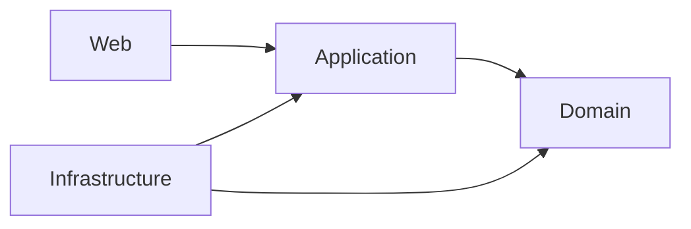

# Cinema

Cinema được xây lại theo Clean Architecture. Đã hoàn thiện **M0 — nền kiến trúc**, **M1 — Venue**, **M2 — Movie**, **M3 — Screening core** và **M4 — Identity + Customer**. Bước tiếp theo theo roadmap là **M5 — Cart + simple SeatHold**; luồng bán vé còn ở mức skeleton.

## Kiến trúc và tài liệu



- [Tổng quan kiến trúc và domain](docs/architecture-contract.md): bản tổng quan, luật nghiệp vụ, workflow, model, ports và cấu trúc source.
- [Lược đồ quan hệ](docs/relational-schema.md): ERD, bảng, khóa, constraint, chỉ mục và transaction.
- [Kế hoạch Cinema V1](docs/cinema-v1-plan.md): kế hoạch đã thống nhất, phạm vi V1 và các nâng cấp Phase 2.
- [Tiến độ Cinema V1](docs/cinema-v1-progress.md): checklist M0–M12, bước tiếp theo và nhật ký thực hiện.
- Các bản phân công M1 cũ được giữ làm lịch sử; M4 có phân công và lịch sử tích hợp riêng tại [overview M4](docs/m4/m4-overview.md).

Tài liệu tổng thể nằm ở docs/; historical artifacts M1 ở [docs/m1/](docs/m1/), tài liệu M2 ở [docs/m2/](docs/m2/).
M2: [đặc tả](docs/m2/m2-specification.md), [triển khai](docs/m2/m2-implementation.md), [nghiệm thu](docs/m2/m2-acceptance.md).
M3: [đặc tả](docs/m3/m3-specification.md), [triển khai](docs/m3/m3-implementation.md), [nghiệm thu](docs/m3/m3-acceptance.md).
M4: [tổng quan và phân công](docs/m4/m4-overview.md), [triển khai](docs/m4/m4-implementation.md), [nghiệm thu](docs/m4/m4-acceptance.md).

## Chạy và kiểm tra

Đặc tả M1: [Cinema / Hall / Seat](docs/m1/m1-specification.md).
M1 đã hoàn thành theo quy trình dự án cá nhân; luồng tạo/đọc đã được kiểm chứng qua HTTP thật.
Xem [bằng chứng nghiệm thu](docs/m1/m1-acceptance.md).

Dùng JDK 25. Dự án đã có Maven Wrapper:

```powershell
.\mvnw.cmd clean verify
.\mvnw.cmd spring-boot:run
```

Nếu Maven trỏ cache vào `C:\.m2` và không ghi được, truyền `-Dmaven.repo.local` với đường dẫn cache có quyền truy cập.

## Trạng thái triển khai

Ứng dụng khởi động không cần database, Redis hay RabbitMQ. Profile mặc định
vẫn deny-all. Profile venue-dev đã có controller, handler và repository in-memory
thật cho Cinema/Hall/Seat, Movie, Screening và Identity + Customer, cùng xử lý lỗi 400/403/404/409.

Chạy cấu hình phát triển M1–M4:

```powershell
.\mvnw.cmd spring-boot:run '-Dspring-boot.run.profiles=venue-dev'
```

M1/M2/M3/M4 dùng in-memory, mất dữ liệu khi khởi động lại. Movie dùng InMemoryMovieRepository; Screening dùng InMemoryScreeningRepository. Movie và Screening JPA persistence chưa được triển khai.
MovieController, bốn handler beans và repository chỉ active trong venue-dev; default context vẫn khởi động và deny-all.

Checkpoint M2 ngày 2026-09-25: clean test — 230 tests, 0 failures, 0 errors, 8 skipped (workflow skeleton hiện có).
Checkpoint M3 ngày 2026-09-25: clean test — 299 tests, 0 failures, 0 errors, 8 skipped; 8 skipped thuộc BookingWorkflowTest. M3 không bao gồm GetAvailableSeats, SeatHold, Booking/Checkout hoặc Payment.

Handler chưa implement sẽ ném `FeatureNotImplementedException`. Domain method và adapter chưa implement sẽ ném `UnsupportedOperationException`. `BaseEntity` từ chối ID null/blank; `Money` từ chối amount/currency null và số tiền âm. Các invariant nghiệp vụ khác còn phải triển khai theo milestone. JPA entity mới có ID, phần mapping còn phải làm tiếp.

Test kiểm tra luật nền tảng, dependency, khởi động/security, Venue và Movie qua Domain/Application/repository/HTTP; các handler skeleton còn lại được kiểm tra theo contract chưa implement. M0 có 13 domain test và 6 architecture test đạt, không bỏ qua. `BookingWorkflowTest` còn 8 test skeleton bị `@Disabled`, thuộc các bước triển khai sau.

Source cũ và SQL migration cũ đã được thay bằng skeleton; database bên ngoài không bị thay đổi trong bước dựng lại đó.

### Identity API trong venue-dev

M4 Identity + Customer **COMPLETED**: Customer, Register, Login, Current User,
Identity HTTP API và venue-dev integration. Customer liên kết identity userId;
Register trả customer ID.

| Method | Path | Success |
| --- | --- | --- |
| POST | /identity/register | 201 + {"id":"<customerId>"} |
| POST | /identity/login | 200 + accessToken, expiresAt |
| GET | /identity/me | 200 + userId, authenticated; chưa xác thực: null, false |

Register nhận email/password/displayName; Login nhận email/password.
Email trùng trả 409 CONFLICT; sai credentials trả 403 FORBIDDEN.
Login phát access token UUID, nhưng bearer-token verification và SecurityContext
authentication còn deferred sau M4. M4 chưa có production/JWT authentication;
Identity và Customer persistence hiện là in-memory.
Focused M4 tests và full regression đã được chủ dự án xác nhận BUILD SUCCESS;
không chạy lại Maven khi đóng tài liệu.

### Screening API trong venue-dev

M3 Screening core đã hoàn thành: tạo, đọc, liệt kê theo Movie, hủy Screening,
bảo vệ overlap trong cùng Hall, lifecycle `SCHEDULED -> CANCELLED`, in-memory
persistence, HTTP API và security boundary.

| Method | Path | Success |
| --- | --- | --- |
| POST | /screenings | 201 + {"id":"..."} |
| GET | /screenings/{id} | 200 + ScreeningView |
| GET | /screenings?movieId={movieId} | 200 + List<ScreeningView> |
| POST | /screenings/{id}/cancel | 204, không body |

Cancel không xóa resource; sau khi cancel, GET vẫn trả Screening với status `CANCELLED`.
GetAvailableSeats, SeatHold, Booking/Checkout, Payment và Screening JPA persistence
vẫn deferred.

### Movie API trong venue-dev

M2 được triển khai toàn bộ bởi Nghia.

| Method | Path | Success |
| --- | --- | --- |
| POST | /movies | 201 + {"id":"..."} |
| GET | /movies | 200 + danh sách MovieView |
| GET | /movies/{id} | 200 + MovieView |
| DELETE | /movies/{id} | 204, không body |

Request tạo phim: title, description, durationMinutes, ageRating.
MovieView gồm id, title, description, durationMinutes, ageRating, status.
Movie mới có status COMING_SOON; enum gồm COMING_SOON, SHOWING, ARCHIVED.
Title nonblank, durationMinutes > 0; input sai trả 400 VALIDATION, phim thiếu trả 404 NOT_FOUND.

Lệnh checkpoint đã xác minh:

```powershell
.\mvnw.cmd '-Dmaven.repo.local=C:\Users\admin\.m2\repository' -o clean test
```
