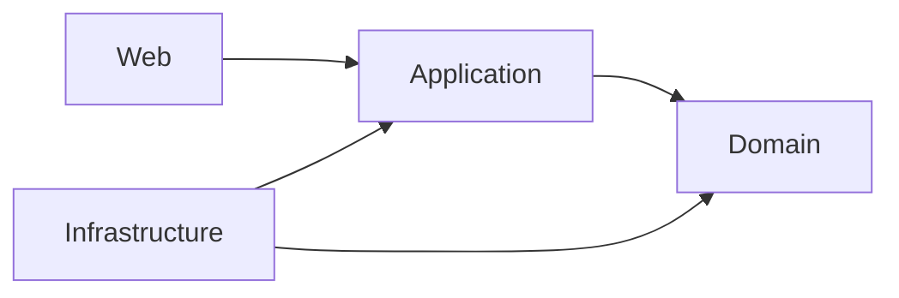

# Cinema

Backend đặt vé xem phim theo Clean Architecture, Java 25 / Spring Boot 3.5.
Code hiện tại đã có luồng đăng ký → đăng nhập → chọn ghế → checkout → thanh toán giả lập → nhận vé, persistence MySQL và phân quyền CUSTOMER/ADMIN.

## Trạng thái

| Phần việc | Đã triển khai |
| --- | --- |
| M0–M7 | Nền kiến trúc, rạp/phòng/ghế, phim, suất chiếu, customer, cart, booking, FakePaymentGateway |
| Package 1 — M8–M10 | Ticket, hoàn tất đặt ghế, ownership, REST; sửa race giữ ghế/cart/checkout |
| Package 2 — M11 | JPA/MySQL, Flyway V1/V2, transaction, database locks/constraints, soft-delete movie |
| Package 3 — Authentication | Bearer token lưu hash trong MySQL, hạn 1 giờ, CUSTOMER/ADMIN, Flyway V3 |

Đây là trạng thái code trên feature branch, không phải khẳng định đã merge/deploy. Package 3 dựa trên Package 2; review và merge theo thứ tự 2 → 3. M12 (Docker/OpenAPI/benchmark) đã nghiệm thu trên `feature/nghia/m12-delivery`; xem [bằng chứng](docs/m12/acceptance.md). Frontend chưa triển khai.

## Bằng chứng Pha 1

[Checklist yêu cầu](docs/phase1/requirements-checklist.md) và [báo cáo Kaggle CPU](docs/phase1/kaggle-results.md) đối chiếu commit `a51fb7f`. Tải đọc đạt tiêu chí khảo sát ở 25 người dùng; tại 50 người dùng, p95 đọc ghế là 2,106 giây với 0% lỗi HTTP. Kiểm tra 30 lượt đặt ghế riêng và 10 khách tranh một ghế đều đạt. Đã lưu ba báo cáo JSON và [notebook chạy lại](benchmarks/kaggle/README.md). Frontend không bắt buộc cho Pha 1.

## Kiến trúc



Domain giữ invariant và không phụ thuộc Spring/JPA. Application dùng ports; Infrastructure cung cấp persistence, transaction và token service. Web xử lý HTTP, authentication và authorization.

## Chạy local với MySQL

Cần JDK 25, MySQL và Maven hoặc Maven Wrapper có sẵn. Tạo database bằng Workbench trên server dự định sử dụng (ví dụ port 3306):

```sql
CREATE DATABASE cinema_package2
CHARACTER SET utf8mb4 COLLATE utf8mb4_bin;
```

Nếu database đã tồn tại, dùng lại; không xóa/tạo lại để nâng phiên bản. Sao lưu trước khi áp dụng migration lên dữ liệu cần giữ.

**Windows CMD** — đặt biến và chạy trong cùng cửa sổ:

```bat
cd /d D:\Cinema
set "SPRING_PROFILES_ACTIVE=mysql"
set "CINEMA_DB_URL=jdbc:mysql://localhost:3306/cinema_package2?connectionTimeZone=UTC"
set "CINEMA_DB_USER=YOUR_DATABASE_USER"
set "CINEMA_DB_PASSWORD=YOUR_DATABASE_PASSWORD"
mvnw.cmd spring-boot:run
```

Thay các giá trị `YOUR_...` bằng thông tin local, không commit mật khẩu. Biến CMD không tự áp dụng cho terminal mới hoặc IDE. PowerShell dùng `$env:TEN_BIEN='gia-tri'`, không dùng cú pháp `set` ở trên.

Flyway tự áp dụng V1–V3; Hibernate dùng `ddl-auto=validate`. Database Package 2 đã có V1/V2 được nâng bằng V3. URL mặc định khi thiếu `CINEMA_DB_URL` là `localhost:3306/cinema`, không phải `cinema_package2`. Ứng dụng mặc định nghe HTTP port 8080.

| Profile | Persistence / Security |
| --- | --- |
| Không profile | Không cần database; HTTP deny-all |
| `venue-dev` | In-memory, mất dữ liệu sau restart; token đăng nhập thử chưa dùng xác thực Bearer |
| `mysql` | JPA/MySQL; Bearer authentication và phân quyền |
| `mysql,venue-dev` | MySQL adapters và MySQL security được ưu tiên |

Chỉ chạy bản in-memory: `mvnw.cmd spring-boot:run -Dspring-boot.run.profiles=venue-dev` trong terminal không đặt profile MySQL.

## API và quyền trong MySQL

- `POST /identity/register`: `email`, `password`, `displayName`; trả 201 và customer ID. Tài khoản luôn bắt đầu với CUSTOMER.
- `POST /identity/login`: `email`, `password`; trả `accessToken`, `expiresAt`.
- Gửi `Authorization: Bearer <accessToken>` khi gọi API cần đăng nhập. Token là chuỗi ngẫu nhiên, không phải JWT; database chỉ lưu SHA-256 của token, password dùng PBKDF2.
- GET danh mục rạp/phòng/ghế/phim/suất chiếu/available-seats là public. Tạo danh mục, xóa phim và hủy suất chiếu cần ADMIN.
- Cart, booking, payment, ticket và `/identity/me` cần CUSTOMER hoặc ADMIN. ADMIN không được bỏ qua ownership của booking/ticket.
- Lỗi giữ contract hiện có: 400 validation, 403 authentication/authorization, 404 missing resource, 409 conflict. Trong MySQL, `/identity/me` không có token trả 403; venue-dev vẫn giữ contract cũ.

Không có admin mặc định. Sau khi đăng ký, quản trị database có thể cấp quyền cho tài khoản đã chọn:

```sql
UPDATE user_records SET role = 'ADMIN' WHERE email = 'your-admin-email';
```

Luồng customer: `POST /carts/seats` → `POST /bookings/checkout` → `POST /payments/{bookingId}` → `GET /tickets/me`. Checkout tạo một booking cho mỗi screening. Thanh toán thành công xác nhận booking, giữ chỗ vĩnh viễn và phát một ticket cho mỗi item; retry thành công đã commit không gọi gateway lại.

## Kiểm thử và giới hạn

```bat
mvnw.cmd clean test
git diff --check
```

MySQL contract được bật khi có `CINEMA_TEST_MYSQL_URL`; cấu hình tài khoản bằng `CINEMA_TEST_MYSQL_USER`, `CINEMA_TEST_MYSQL_PASSWORD` và dùng database test riêng. Không dùng database làm việc. Xem [hướng dẫn MySQL](docs/mysql.md) về quyền tạo schema cho test migration.

Kết quả đã ghi nhận ở commit `10f53a4`: **787 tests, 0 failures, 0 errors, 8 skips có sẵn**; 29 contract tests mỗi loại trên H2 và MySQL 9.4 thực tế. Đây là kết quả trước đợt cập nhật tài liệu, không phải test vừa chạy. H2-only không chứng minh tương thích MySQL.

Giới hạn V1: FakePaymentGateway; chưa có hold TTL, refresh/logout/reset password/rate limiting hoặc dọn token hết hạn tự động. Gateway thành công nhưng database rollback trước commit vẫn có thể khiến retry gọi gateway lại. Không có Redis/RabbitMQ hoặc thanh toán thật. Cần HTTPS ngoài localhost. Frontend và CORS/dev proxy còn là công việc tiếp theo. Xem [nghiệm thu M12](docs/m12/acceptance.md).

## Tài liệu

- [Tiến độ và bằng chứng kiểm thử](docs/cinema-v1-progress.md)
- [Kế hoạch và công việc tiếp theo](docs/cinema-v1-plan.md)
- [Phân công, lịch sử và review](docs/team-work-allocation.md)
- [Kiến trúc và đặc tả domain](docs/architecture-contract.md)
- [Schema thực tế theo Flyway](docs/relational-schema.md)
- [MySQL, authentication và giới hạn transaction](docs/mysql.md)
- [Package 1 — hồ sơ bàn giao](docs/backend-package-1.md)

Các tài liệu `docs/m1/` đến `docs/m7/` là hồ sơ từng milestone tại thời điểm thực hiện. Những mô tả như “JPA/Bearer deferred” trong hồ sơ cũ không phải trạng thái hiện tại; xem progress và mysql.md trước khi giao việc mới.


## Giới hạn hiện tại và hướng cải tiến

Phạm vi đối chiếu: nhánh `main`, commit `7d49cda`. Các hướng cải tiến dưới đây chưa phải chức năng đã triển khai.

### 1. Thanh toán

**Hiện trạng**
- Sử dụng `FakePaymentGateway`, chưa tích hợp thanh toán thật.
- Khi kết quả thanh toán thành công đã được commit, yêu cầu lặp lại không gọi gateway lần nữa.
- Nếu gateway thành công nhưng database rollback trước khi commit, lần thử lại vẫn có thể gọi gateway thêm lần nữa.

**Hướng cải tiến**
- Tích hợp cổng thanh toán thật và xác minh chữ ký thông báo kết quả.
- Đối chiếu mã đơn, số tiền và mã giao dịch trước khi xác nhận booking.
- Sử dụng idempotency key được cổng thanh toán hỗ trợ.
- Bổ sung trạng thái chờ xác minh và cơ chế đối soát; không mặc định timeout là thanh toán thất bại.

### 2. Thời hạn giữ ghế

**Hiện trạng**
- Chưa có cơ chế giữ ghế tự hết hạn.
- Khách bỏ dở thao tác có thể khiến ghế tiếp tục bị giữ nếu không được giải phóng qua luồng hiện có.

**Hướng cải tiến**
- Bổ sung thời điểm hết hạn và kiểm tra hiệu lực khi checkout, thanh toán.
- Bổ sung cơ chế giải phóng giữ ghế hết hạn.
- Quy định thời hạn thanh toán của booking và xử lý khi quá hạn.
- Giải quyết rõ trường hợp thanh toán thành công sau khi quyền giữ ghế đã hết hạn.

### 3. Xử lý đồng thời và mở rộng

**Hiện trạng**
- Backend hỗ trợ xử lý nhiều request đồng thời.
- Có `synchronized`, transaction và khóa database để kiểm soát tranh chấp.
- Giữ ghế khóa ở cấp suất chiếu, nên các yêu cầu chọn ghế khác nhau trong cùng suất vẫn có thể phải chờ nhau.
- `synchronized(bookings)` trong xử lý thanh toán có thể khiến các booking khác nhau chờ nhau trong cùng tiến trình.
- `synchronized` không bảo vệ giữa các instance backend khác nhau.

**Hướng cải tiến**
- Đo thời gian chờ khóa trước khi tối ưu.
- Cân nhắc thu hẹp phạm vi khóa theo ghế hoặc booking.
- Kiểm thử ít nhất hai instance dùng chung MySQL.
- Kiểm chứng đồng thời các luồng giữ ghế, checkout, hủy booking và thanh toán; không dựa riêng vào khóa trong bộ nhớ.

### 4. Xác thực và bảo mật

**Hiện trạng**
- Có Bearer token thời hạn một giờ và phân quyền CUSTOMER/ADMIN.
- Chưa có logout thu hồi token, refresh token, đặt lại mật khẩu hoặc dọn token hết hạn tự động.
- Chưa có rate limiting.

**Hướng cải tiến**
- Hoàn thiện vòng đời token và cơ chế thu hồi.
- Bổ sung quy trình khôi phục tài khoản.
- Giới hạn tần suất truy cập theo tài khoản/IP và từng loại API.
- Kiểm thử token hết hạn, bị thu hồi, thay đổi quyền và truy cập dữ liệu không thuộc sở hữu.

### 5. Tích hợp frontend

**Hiện trạng**
- Chưa triển khai frontend.
- CORS hoặc proxy cho môi trường phát triển còn cần hoàn thiện.

**Hướng cải tiến**
- Dùng đặc tả OpenAPI làm hợp đồng tích hợp.
- Thống nhất địa chỉ API, cách gửi token và định dạng lỗi.
- Xử lý trên giao diện các tình huống ghế vừa bị người khác giữ, hết hạn giữ ghế và thanh toán chưa rõ kết quả.

### 6. Triển khai và vận hành

**Hiện trạng**
- Có Dockerfile và Docker Compose phục vụ chạy local.
- Compose mặc định chỉ mở backend trên `127.0.0.1`.
- Cấu hình local chưa phải cấu hình production hoàn chỉnh.

**Hướng cải tiến**
- Bổ sung HTTPS/reverse proxy và quản lý bí mật cho môi trường triển khai.
- Thiết lập log tập trung, giám sát và cảnh báo.
- Xây dựng quy trình sao lưu, khôi phục và nâng cấp database.
- Kiểm tra khả năng khôi phục thực tế, không chỉ kiểm tra việc tạo bản sao lưu.

### 7. Kiểm thử và hiệu năng

**Hiện trạng**
- Repository có kiểm thử và hồ sơ benchmark.
- Kết quả benchmark phụ thuộc môi trường, dữ liệu và kịch bản chạy; chưa thể dùng để khẳng định năng lực production.

**Hướng cải tiến**
- Chạy lại kiểm thử trên mốc commit bàn giao.
- Đo tải trên môi trường triển khai dự kiến với cả luồng đọc và đặt vé.
- Theo dõi độ trễ p95/p99, tỷ lệ lỗi, thời gian chờ khóa và mức sử dụng kết nối database.
- Bổ sung tình huống lỗi gateway, lỗi database, khởi động lại dịch vụ và chạy nhiều instance.
