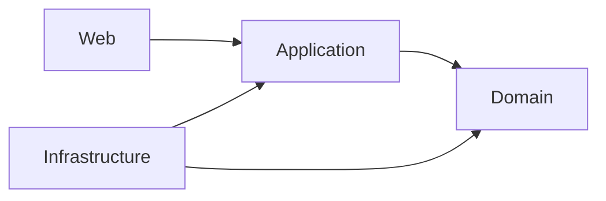

# Cinema

Backend đặt vé xem phim theo Clean Architecture, Java 25 / Spring Boot 3.5.
Code hiện tại đã có luồng đăng ký → đăng nhập → chọn ghế → checkout → thanh toán giả lập → nhận vé, persistence MySQL và phân quyền CUSTOMER/ADMIN.

## Trạng thái

| Phần việc | Đã triển khai |
| --- | --- |
| M0–M7 | Nền kiến trúc, rạp/phòng/ghế, phim, suất chiếu, customer, cart, booking, FakePaymentGateway |
| Package 1 — M8–M10 | Ticket, hoàn tất đặt ghế, ownership, REST; sửa race giữ ghế/cart/checkout |
| Package 2 — M11 | JPA/MySQL, Flyway V1/V2, transaction, database locks/constraints, soft-delete movie |
| Package 3 — Authentication | Bearer token lưu hash trong MySQL, hạn 1 giờ, CUSTOMER/ADMIN, Flyway V3 |

Đây là trạng thái code trên feature branch, không phải khẳng định đã merge/deploy. Package 3 dựa trên Package 2; review và merge theo thứ tự 2 → 3. M12 (Docker/OpenAPI/benchmark) đã nghiệm thu trên `feature/nghia/m12-delivery`; xem [bằng chứng](docs/m12/acceptance.md). Frontend chưa triển khai.

## Bằng chứng Pha 1

[Checklist yêu cầu](docs/phase1/requirements-checklist.md) và [báo cáo Kaggle CPU](docs/phase1/kaggle-results.md) đối chiếu commit `a51fb7f`. Tải đọc đạt tiêu chí khảo sát ở 25 người dùng; tại 50 người dùng, p95 đọc ghế là 2,106 giây với 0% lỗi HTTP. Kiểm tra 30 lượt đặt ghế riêng và 10 khách tranh một ghế đều đạt. Đã lưu ba báo cáo JSON và [notebook chạy lại](benchmarks/kaggle/README.md). Frontend không bắt buộc cho Pha 1.

## Kiến trúc



Domain giữ invariant và không phụ thuộc Spring/JPA. Application dùng ports; Infrastructure cung cấp persistence, transaction và token service. Web xử lý HTTP, authentication và authorization.

## Chạy local với MySQL

Cần JDK 25, MySQL và Maven hoặc Maven Wrapper có sẵn. Tạo database bằng Workbench trên server dự định sử dụng (ví dụ port 3306):

```sql
CREATE DATABASE cinema_package2
CHARACTER SET utf8mb4 COLLATE utf8mb4_bin;
```

Nếu database đã tồn tại, dùng lại; không xóa/tạo lại để nâng phiên bản. Sao lưu trước khi áp dụng migration lên dữ liệu cần giữ.

**Windows CMD** — đặt biến và chạy trong cùng cửa sổ:

```bat
cd /d D:\Cinema
set "SPRING_PROFILES_ACTIVE=mysql"
set "CINEMA_DB_URL=jdbc:mysql://localhost:3306/cinema_package2?connectionTimeZone=UTC"
set "CINEMA_DB_USER=YOUR_DATABASE_USER"
set "CINEMA_DB_PASSWORD=YOUR_DATABASE_PASSWORD"
mvnw.cmd spring-boot:run
```

Thay các giá trị `YOUR_...` bằng thông tin local, không commit mật khẩu. Biến CMD không tự áp dụng cho terminal mới hoặc IDE. PowerShell dùng `$env:TEN_BIEN='gia-tri'`, không dùng cú pháp `set` ở trên.

Flyway tự áp dụng V1–V3; Hibernate dùng `ddl-auto=validate`. Database Package 2 đã có V1/V2 được nâng bằng V3. URL mặc định khi thiếu `CINEMA_DB_URL` là `localhost:3306/cinema`, không phải `cinema_package2`. Ứng dụng mặc định nghe HTTP port 8080.

| Profile | Persistence / Security |
| --- | --- |
| Không profile | Không cần database; HTTP deny-all |
| `venue-dev` | In-memory, mất dữ liệu sau restart; token đăng nhập thử chưa dùng xác thực Bearer |
| `mysql` | JPA/MySQL; Bearer authentication và phân quyền |
| `mysql,venue-dev` | MySQL adapters và MySQL security được ưu tiên |

Chỉ chạy bản in-memory: `mvnw.cmd spring-boot:run -Dspring-boot.run.profiles=venue-dev` trong terminal không đặt profile MySQL.

## API và quyền trong MySQL

- `POST /identity/register`: `email`, `password`, `displayName`; trả 201 và customer ID. Tài khoản luôn bắt đầu với CUSTOMER.
- `POST /identity/login`: `email`, `password`; trả `accessToken`, `expiresAt`.
- Gửi `Authorization: Bearer <accessToken>` khi gọi API cần đăng nhập. Token là chuỗi ngẫu nhiên, không phải JWT; database chỉ lưu SHA-256 của token, password dùng PBKDF2.
- GET danh mục rạp/phòng/ghế/phim/suất chiếu/available-seats là public. Tạo danh mục, xóa phim và hủy suất chiếu cần ADMIN.
- Cart, booking, payment, ticket và `/identity/me` cần CUSTOMER hoặc ADMIN. ADMIN không được bỏ qua ownership của booking/ticket.
- Lỗi giữ contract hiện có: 400 validation, 403 authentication/authorization, 404 missing resource, 409 conflict. Trong MySQL, `/identity/me` không có token trả 403; venue-dev vẫn giữ contract cũ.

Không có admin mặc định. Sau khi đăng ký, quản trị database có thể cấp quyền cho tài khoản đã chọn:

```sql
UPDATE user_records SET role = 'ADMIN' WHERE email = 'your-admin-email';
```

Luồng customer: `POST /carts/seats` → `POST /bookings/checkout` → `POST /payments/{bookingId}` → `GET /tickets/me`. Checkout tạo một booking cho mỗi screening. Thanh toán thành công xác nhận booking, giữ chỗ vĩnh viễn và phát một ticket cho mỗi item; retry thành công đã commit không gọi gateway lại.

## Kiểm thử và giới hạn

```bat
mvnw.cmd clean test
git diff --check
```

MySQL contract được bật khi có `CINEMA_TEST_MYSQL_URL`; cấu hình tài khoản bằng `CINEMA_TEST_MYSQL_USER`, `CINEMA_TEST_MYSQL_PASSWORD` và dùng database test riêng. Không dùng database làm việc. Xem [hướng dẫn MySQL](docs/mysql.md) về quyền tạo schema cho test migration.

Kết quả đã ghi nhận ở commit `10f53a4`: **787 tests, 0 failures, 0 errors, 8 skips có sẵn**; 29 contract tests mỗi loại trên H2 và MySQL 9.4 thực tế. Đây là kết quả trước đợt cập nhật tài liệu, không phải test vừa chạy. H2-only không chứng minh tương thích MySQL.

Giới hạn V1: FakePaymentGateway; chưa có hold TTL, refresh/logout/reset password/rate limiting hoặc dọn token hết hạn tự động. Gateway thành công nhưng database rollback trước commit vẫn có thể khiến retry gọi gateway lại. Không có Redis/RabbitMQ hoặc thanh toán thật. Cần HTTPS ngoài localhost. Frontend và CORS/dev proxy còn là công việc tiếp theo. Xem [nghiệm thu M12](docs/m12/acceptance.md).

## Tài liệu

- [Tiến độ và bằng chứng kiểm thử](docs/cinema-v1-progress.md)
- [Kế hoạch và công việc tiếp theo](docs/cinema-v1-plan.md)
- [Phân công, lịch sử và review](docs/team-work-allocation.md)
- [Kiến trúc và đặc tả domain](docs/architecture-contract.md)
- [Schema thực tế theo Flyway](docs/relational-schema.md)
- [MySQL, authentication và giới hạn transaction](docs/mysql.md)
- [Package 1 — hồ sơ bàn giao](docs/backend-package-1.md)

Các tài liệu `docs/m1/` đến `docs/m7/` là hồ sơ từng milestone tại thời điểm thực hiện. Những mô tả như “JPA/Bearer deferred” trong hồ sơ cũ không phải trạng thái hiện tại; xem progress và mysql.md trước khi giao việc mới.


Các việc cần tiếp tục

Xây dựng frontend và cấu hình kết nối với backend.

Bổ sung thời hạn giữ ghế và giải phóng ghế hết hạn.

Thay FakePaymentGateway bằng cổng thanh toán thật.

Xử lý trường hợp gateway thành công nhưng transaction database thất bại, để retry không gây thu tiền lặp.

Bổ sung logout, refresh token, đặt lại mật khẩu và giới hạn tần suất yêu cầu.

Chuẩn bị HTTPS, quản lý bí mật và giám sát khi triển khai thực tế.
