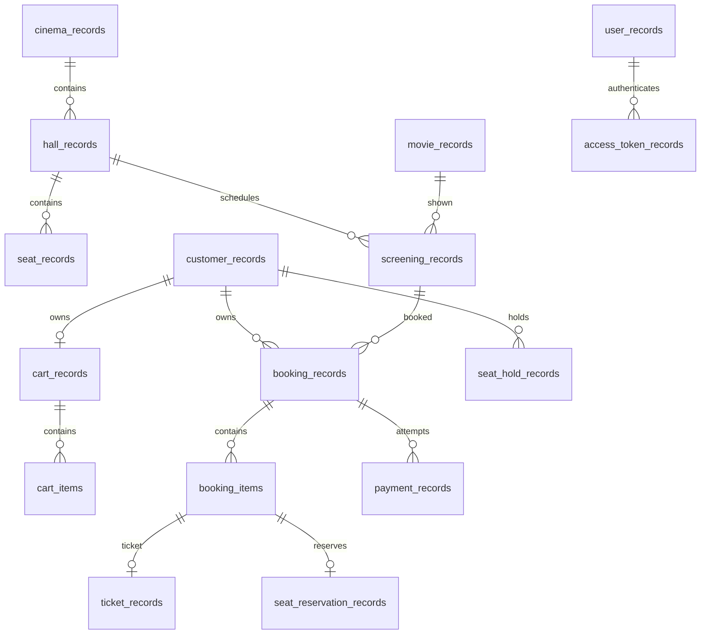

# Schema MySQL thực tế — Cinema V1

Cập nhật 2026-10-10, đối chiếu migrations V1–V3 và code đến `10f53a4`. Tài liệu này thay bản schema đề xuất cũ; SQL trong [db/migration](../src/main/resources/db/migration/) là nguồn chính xác khi có khác biệt.

## Migration và kiểu dữ liệu

- [V1](../src/main/resources/db/migration/V1__init_schema.sql): 15 bảng nghiệp vụ/identity/hold.
- [V2](../src/main/resources/db/migration/V2__retain_deleted_movie_references.sql): thêm `movie_records.deleted`, không xóa phim đang được tham chiếu.
- [V3](../src/main/resources/db/migration/V3__authentication_tokens_and_roles.sql): thêm user role và `access_token_records`.
- Tổng cộng 16 bảng ứng dụng, ngoài `flyway_schema_history`.
- ID thông thường `VARCHAR(128)`; token hash `VARCHAR(64)` làm PK riêng. Tiền `DECIMAL(38,12)` + `VARCHAR(3)` currency; timestamp `DATETIME(6)` và JDBC UTC. Enum lưu chuỗi, không tạo bảng enum.
- MySQL dùng InnoDB/utf8mb4/utf8mb4_bin; Hibernate `validate`, không `ddl-auto=update`. Không sửa migration đã áp dụng.

## Bảng và constraints chính

| Bảng | Dữ liệu / khóa |
| --- | --- |
| `cinema_records` | id, name, address |
| `hall_records` | FK cinema_id; UNIQUE(cinema_id, name) |
| `seat_records` | FK hall_id; seat_row, seat_number, seat_type; UNIQUE(hall_id, seat_row, seat_number) |
| `movie_records` | title, description, duration_minutes, age_rating, status, deleted |
| `screening_records` | FK movie_id/hall_id; start_time, end_time, amount/currency, status; index(hall_id, start_time, end_time) |
| `user_records` | UNIQUE email, password_hash PBKDF2, role CUSTOMER/ADMIN mặc định CUSTOMER |
| `customer_records` | UNIQUE user_id, display_name; liên kết identity qua ứng dụng, **chưa có FK user_id tới user_records** |
| `cart_records` | FK customer_id, UNIQUE customer_id |
| `cart_items` | PK(cart_id, item_index); UNIQUE(cart_id, screening_id, seat_id); FK cart/screening/seat; amount/currency |
| `booking_records` | FK customer_id/screening_id; total qua amount/currency, status, created_at; UNIQUE(id, screening_id) |
| `booking_items` | PK(booking_id, item_index); UNIQUE(booking_id, seat_id); FK booking/seat; amount/currency |
| `payment_records` | FK booking_id; amount/currency, status, provider_reference, UNIQUE successful_booking_id nullable |
| `seat_hold_records` | FK screening/seat/customer; UNIQUE(screening_id, seat_id); chưa có expires_at |
| `seat_reservation_records` | UNIQUE(screening_id, seat_id); FK screening/seat, FK(booking_id, screening_id) và FK(booking_id, seat_id) |
| `ticket_records` | UNIQUE ticket_code và (booking_id, seat_id); FK screening/seat và hai FK ghép như reservation; status |
| `access_token_records` | PK token_hash; FK user_id; expires_at; indexes user_id và expires_at |

`cart_items` và `booking_items` là ordered element collections, không có ID riêng. BookingItem lưu snapshot giá, chưa có snapshot tên/hàng/loại ghế. Không tồn tại các bảng đề xuất cũ `application_users`, `screening_seat_records`, `cart_item_records`, `booking_item_records`, hoặc cột payment `idempotency_key`.

## Quan hệ

Diagram tóm tắt, không thay danh sách FK trong V1. User → Customer là liên kết logic qua user_id, không phải FK database. Membership ghế trong hall của screening được kiểm tra bởi Application; không có FK ghép hall/seat như bản thiết kế cũ.

## Giá trị và invariants

- CHECK trong V1 bảo vệ số ghế/thời lượng > 0, thời gian start < end, amount >= 0 và các tập giá trị seat/screening/booking/payment/ticket. Movie status được kiểm tra qua Domain/mapping, V1 chưa có CHECK cho movie status.
- Role CUSTOMER/ADMIN có CHECK trong V3; đăng ký không nhận quyền ADMIN từ request.
- `successful_booking_id = booking_id` khi status SUCCESS và phải NULL ở status khác. UNIQUE cột này ngăn nhiều SUCCESS cho cùng booking nhưng vẫn cho phép nhiều payment FAILED.
- Ticket UNIQUE(booking_id, seat_id) ngăn phát vé lặp; reservation UNIQUE(screening_id, seat_id) ngăn hai booking chiếm cùng ghế.
- Phim soft-deleted bị ẩn khỏi API đọc; save thông thường không khôi phục deleted=false. FK giữ lịch sử screening/ticket.
- Email hiện không được chuẩn hóa hoa/thường tự động; không suy ra policy case-insensitive từ schema.

## Transactions và concurrency

Command handlers được Infrastructure bọc transaction READ COMMITTED. Customer row lock được lấy trước cart read/mutation, bao gồm cart đầu tiên. Booking lock bảo vệ payment retry/cancellation. Screening lock phối hợp hold/reservation; hall lock bảo vệ kiểm tra overlap. Constraint database là lớp bảo vệ thêm; Java `synchronized` không phải cơ chế bảo vệ liên instance.

Checkout kiểm tra hold ownership, nhóm theo screening, lưu booking/items và clear cart cùng transaction. Payment thành công lưu payment, confirm booking, reservation và tickets cùng transaction. Failed payment không tạo reservation/ticket. Paid booking không được hủy qua use case cancel pending; ghế đã booked không được bán lại khi release hold.

Hold chưa có TTL và có thể còn sau payment; permanent reservation là trạng thái quyết định. Deadlock/constraint conflict có thể xảy ra và được ánh xạ ở command boundary; không tuyên bố hệ thống không bao giờ deadlock. Gateway giả đang được gọi trong command transaction; success trước rollback/commit failure vẫn là failure window, retry có thể gọi gateway lại. Chưa có outbox/provider idempotency/refund reconciliation.

Token chỉ lưu hash, hết hạn sau 1 giờ; role được đọc lại ở mỗi lần verify. Database rollback của login không để lại token hợp lệ. Không có refresh/revoke endpoint hoặc expired-token cleanup tự động.

## Bằng chứng

Contract tests trên H2 và MySQL 9.4 thực tế đã kiểm tra migration V2 → V3, round trip, rollback, uniqueness, hai application contexts, retries và restart. Kết quả gần nhất: [progress](cinema-v1-progress.md). Thiết lập môi trường và giới hạn: [mysql.md](mysql.md).
